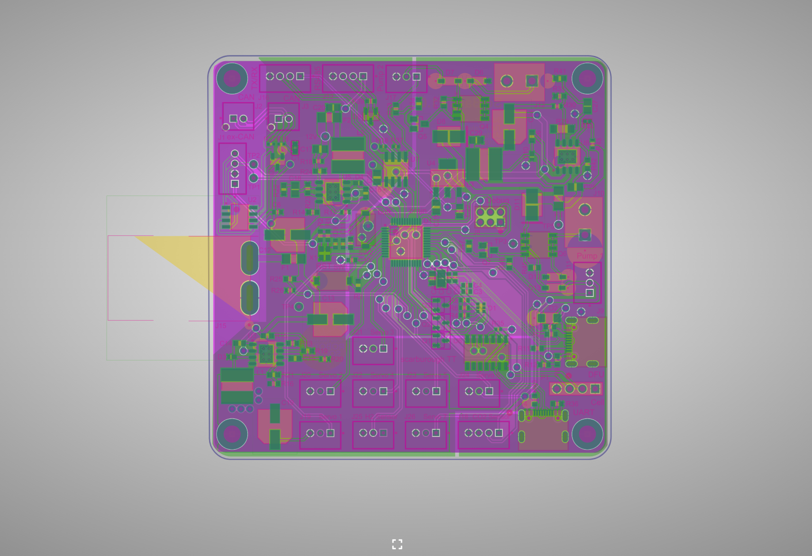

About Me

I’m Matteo; a 3rd electrical engineering student at York University interested in robotics and electronic hardware design. I enjoy tackling hands-on engineering problems and I actively participate in university design clubs and competitions. Currently, I’m the lead PCB designer on the York University Robotics Society Rover Team and I’m currently interning at Hitachi Rail as a Lifecycle Support Intern. 
 
My interest in engineering came from physics and astronomy in high school, I enjoyed these subjects for their ability to explain and describe how the world works through math. This led me to choose electrical engineering where I could combine my interest in physics with the opportunity to design and build practical systems.
 
Going into first year, I decided to join the York University Robotic Society, I joined the Sumobot team, as well as the Rover design team, where I picked up PCB design and electronic hardware development. I still faced lots of difficulty, the first board I led the design of was critical for multiple tasks at the next rover competition. After endless hours of testing, and planning, the design ultimately ended up failing. Power lines were not their required voltages, and caused multiple chips to explode (literally). When the school year started up again, I was tasked with getting this board working for the competition next year. Through systematic testing, I found the board's issues and made a more refined and reliable design that is still used on the rover currently.
 
This experience changed how I approached PCB design and showed me the importance of taking measures to ensure a working board first try. It also taught me how to systematically test for certain issues in a board. After helping with the design of multiple other modules, I was offered to be the lead PCB designer. The image below was that first module I designed, and fixed; for me, it symbolizes persistence, and the light at the end of every tunnel.
 
 

   

 

My biggest inspiration to study STEM was the physicist Richard Feynman, I admired by his ability to deconstruct complex topics into digestible ideas for anyone to understand. He also had a genuine passion for what he taught that inspired me to learn more about physics. This taught me that passion and interest for what you are doing not only makes what you are doing enjoyable but also inspires others too. 

   <i>"Explore the world. Nearly everything is really interesting if you go into it deeply enough"</i>
   
  — Richard Feynman

 

This quote represents curiosity and how it fuels learning. I think he adds exploring a subject deeply enough because being invested in a subject will make learning more like second nature as opposed to a chore, especially for topics you find intriguing. I’m emphasizing this because this is exactly how I became interested in engineering; by being curious.
 
I'm currently interested in opportunities in hardware testing, hardware development, and electronic design, particularly roles that will allow me to expand my technical knowledge, tackle challenging engineering problems, and contribute to the development of reliable electronic systems.
