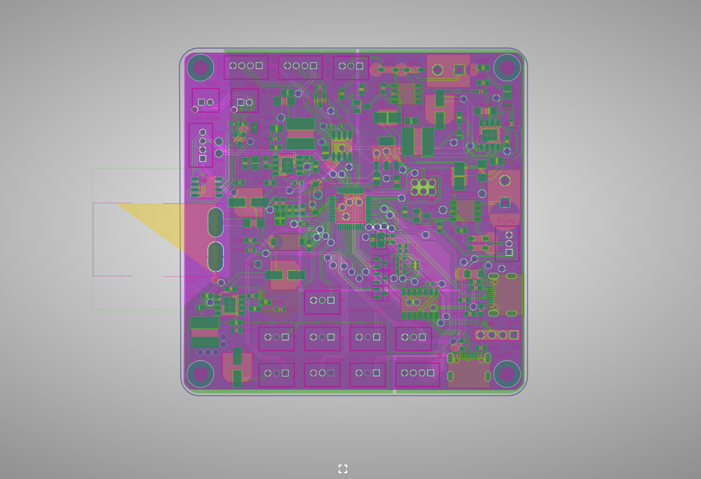

About Me.

I’m Matteo; a 3rd electrical engineering student at York University interested in robotics and electronic hardware design. I like to participate in design clubs and competitions, currently, I’m the lead hardware designer on the York University Robotics Society Rover Team, and I’m also currently interning at Hitachi Rail as a Lifecycle Support Intern. When I reached first year high school, I was introduced to applied sciences, subjects such as astronomy and physics interested me for how much there was to learn about them. By the end of high school, I was dead set on physics, concepts beyond my understanding drew me to want to learn more. To keep my options open, I applied for engineering and physics majors at universities across Ontario, after getting accepted into physics at U of T, and electrical engineering at York, I was at a crossroad. I was always interested in physics, but I also feared that there were few careers available in physics research. I ultimately chose electrical engineering at York University. I was not particularly angry with my choice, after all, engineering is just applied physics. Going into first year, I decided I needed to get myself out there more, I decided to join the York University Robotic Society, I joined the Sumobot team, as well as the Rover design team. PCB design interested me because all electronic components have one, knowing physics also gave me an advantage when understanding how to maintaining the signal integrity of sensitive lines. I still faced lots of difficulty, the first board I led the design of was critical for multiple tasks at the next rover competition. After endless hours of testing, and planning, the design ultimately ended up failing. Power lines were not their required voltages, and this caused multiple chips to explode (literally). This discouraged me, not only did it fail when it was needed the most, but what bugged me was that I no clue why. When the school year started up again, I was tasked with getting this board working for the competition next year. After a lot of trial and error, I got the board working, feeling more fulfilled. This experience ultimately helped me understand how to test the design of board before they are printed, ensuring they work on the first try. It also taught me how to systematically test for certain issues in a board.  After helping with the design of multiple other modules, I was offered to be the lead PCB designer, which I accepted. The image below was that first module I designed, and fixed; for me, it symbolizes persistence, and the light at the end of every tunnel.
 
 

   

 

My biggest inspiration to study STEM was the physicist Richard Feynman, I was inspired by his ability to deconstruct complex physics topics into digestible ideas for anyone to understand, something that can be applied to any STEM field. I also enjoyed the passion he had in his lectures, he explained everything enthusiastically, as if he was having fun thinking about what he was explaining. This taught me that passion and interest for what you are doing not only makes what you are doing enjoyable but also inspires others too. Being invested in whatever I’m doing is a work and lifestyle value that makes it easier for me to try my hardest at whatever I’m doing. The most important work value for me is financial security, such as job security and financial freedom, which could be a decent salary, or opportunity for salary increases. While at work, I like fast-paced, competitive environments, working on a handful of difficult tasks in a small team. Outside of work, I enjoy a work-life balance that doesn’t require me to work on weekends unless under specific circumstances. My lifestyle values are heavily tied to my work values. Financial freedom can include owning my own home. I also want time to myself, being able to live close to work allows me to spend time with my friends often and pursue personal interests. 

   <i>"Explore the world. Nearly everything is really interesting if you go into it deeply enough"</i>
   
  — Richard Feynman

 
This quote represents curiosity and how it fuels learning. I think he adds exploring a subject deeply enough because being invested in a subject will make learning more like second nature as opposed to a chore, especially for topics you find intriguing. I’m emphasizing this because this is exactly how I became interested in engineering; by being curious.
