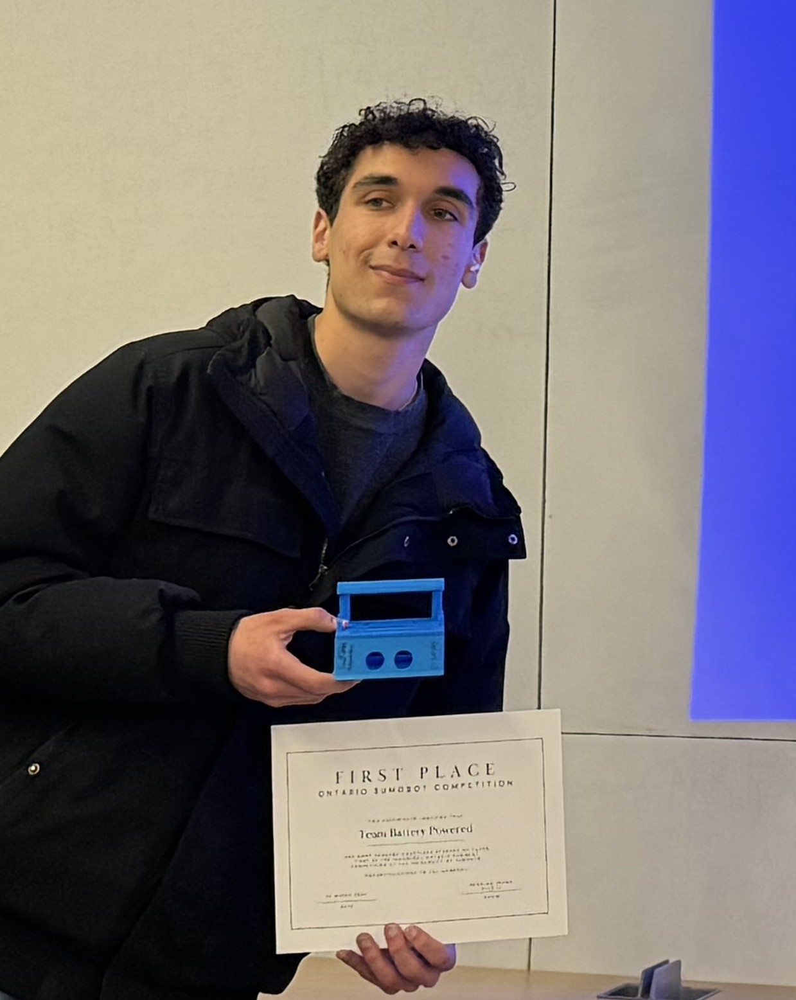

  

            Electrical Engineering Student @ YorkU Lead PCB Designer @ YURS Lifecycle Support Intern @ Hitachi Rail
     <a href="https://github.com/JahshanM" target="_blank" rel="noopener noreferrer">Github</a>
     <a href="http://www.linkedin.com/in/matteo-jahshan-064685327" target="_blank" rel="noopener noreferrer">LinkedIn</a>
     <a href="mailto:jahshan.matteo@gmail.com">Email</a>
  

  

