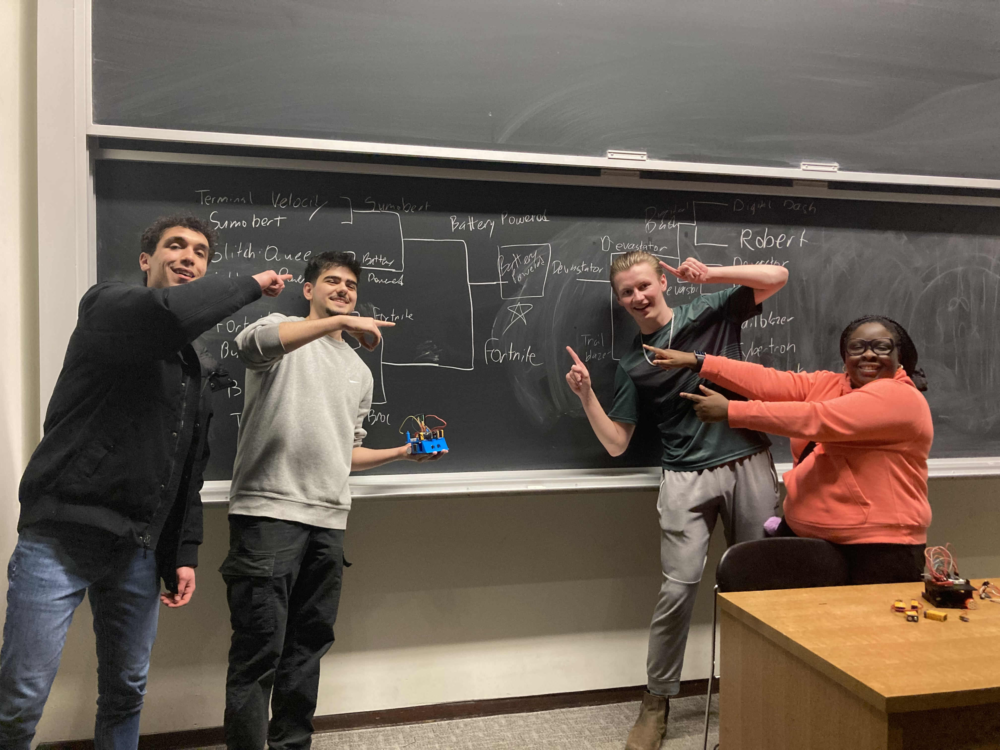
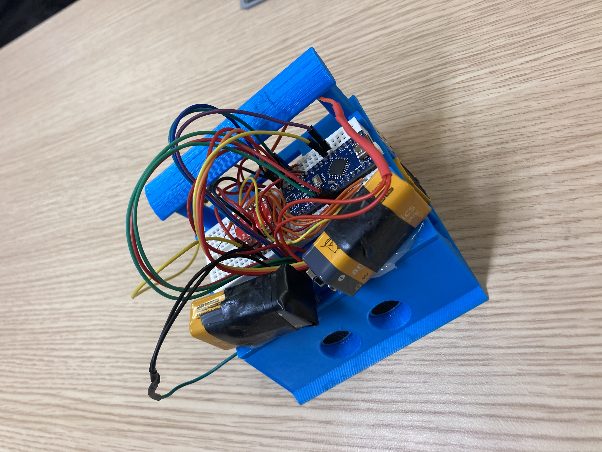

  

             April 2025, Battery Powered placed 1st at the Ontario Sumobot Competition at U of T.
  

  

  

## Battery Powered V1

  

    
  

       Our original strategy was simple: charge towards our opponent as quickly as possible and take them out. If we missed, we continue spinning until we find them.
     
    I designed the chassis, and I did the wiring.
     
    From this, I learned 3D modeling, as well as how to 3D print models

