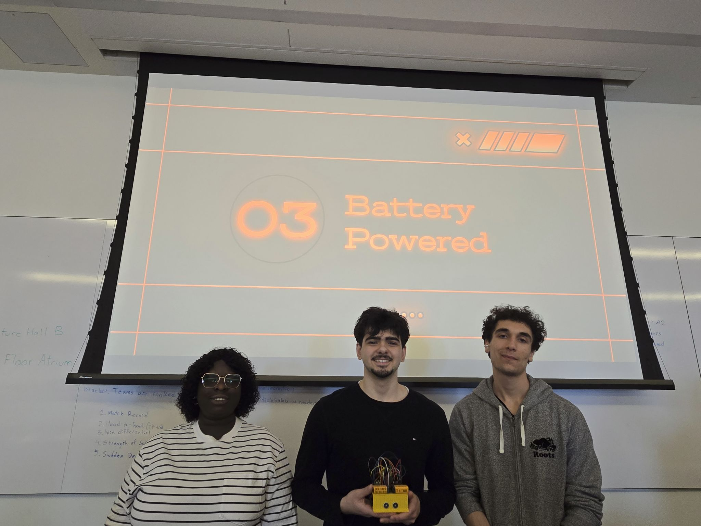

## Battery Powered V1

  

             April 2025, Battery Powered placed 1st at the Ontario Sumobot Competition at U of T.
  

  

  ## Battery Powered V2
  
  For our return, we knew we'd have much more competition.
   
  I introduced an algorithm that allowed our bot to lock onto a target if our bot saw them. I also designed a larger chassis.
   
  We placed 3rd at the 2026 Ontario Sumobot Competition at York University Markham Campus.
   
  From this, I learned how to design and optimize code, as well as how to modify code to effectively interact with the environment.

  

  
  

  

  

