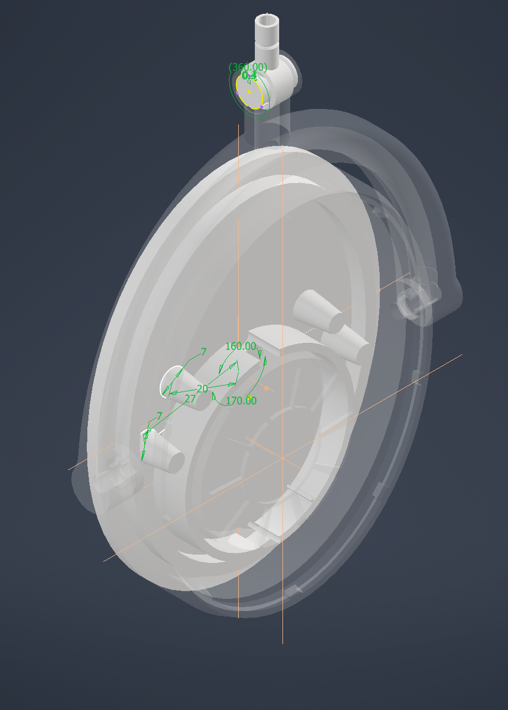

## 3D Model

   

 
3D Model done in Autodesk Inventor
### Chassis Goal:
LED Indicators for battery life and when power is on
Volume up and down button
Adjustable Headset for head size
 
 

## PCB

